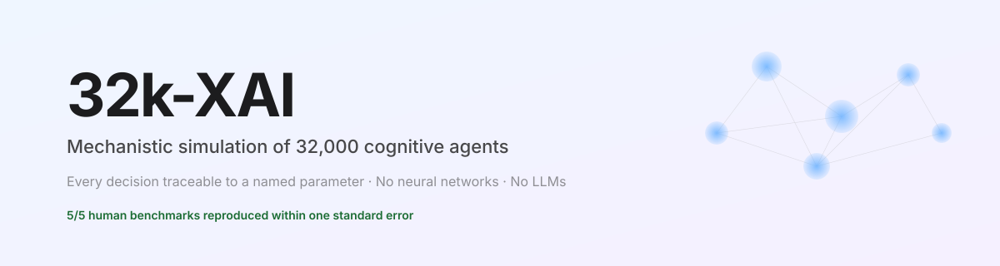
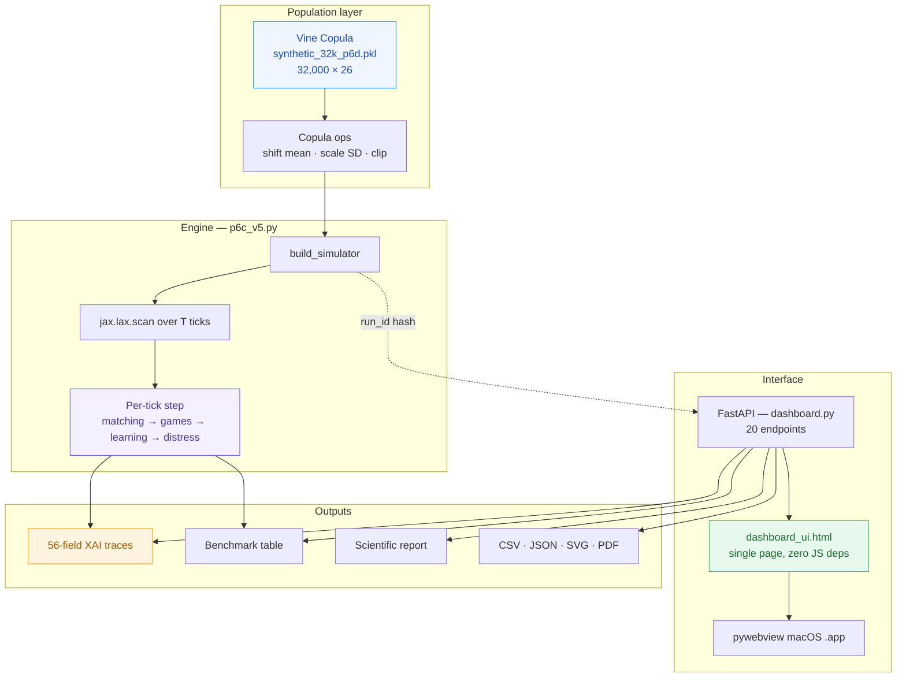
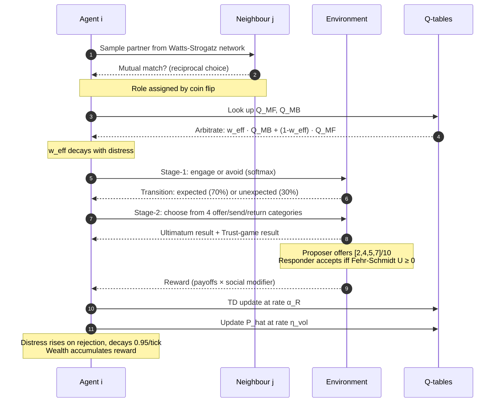

<div align="center">

<picture>
  <source media="(prefers-color-scheme: dark)" srcset="assets/hero-dark.svg">
  <source media="(prefers-color-scheme: light)" srcset="assets/hero-light.svg">
  
</picture>

### Every agent decision traceable to a named parameter.

[](https://github.com/sirkianmj/32k-xai/releases)
[](https://securityscorecards.dev/viewer/?uri=github.com/sirkianmj/32k-xai)
[](#-the-five-human-benchmarks)
[](#-the-population)
[](https://www.python.org/)
[](https://github.com/google/jax)
[](https://fastapi.tiangolo.com/)
[](LICENSE)
[](#-installation)

**[Full Guide](XAI-32k_COMPLETE_GUIDE.html)** &nbsp;·&nbsp;
**[Master Spec](Project%2032k-XAI_%20Master%20Technical%20Specification.pdf)** &nbsp;·&nbsp;
**[Report an issue](https://github.com/sirkianmj/32k-xai/issues)** &nbsp;·&nbsp;
**[Start a discussion](https://github.com/sirkianmj/32k-xai/discussions)**

</div>

---

> [!IMPORTANT]
> **What this is.** A research platform for simulating a society of 32,000 autonomous
> cognitive agents, each governed by a transparent, mechanistically interpretable
> decision architecture. **No neural networks. No large language models.** Every
> action, betrayal, trust allocation, and systemic outcome can be traced to a
> specific named parameter with documented uncertainty and provenance.

> [!NOTE]
> **Why it matters.** Contemporary multi-agent reinforcement learning uses deep
> neural networks as impenetrable black boxes. This platform proposes a different
> path: agents whose "brain" is a small, readable set of mathematical functions —
> temporal-difference learning, two-step Bellman backup, Fehr-Schmidt social
> utility, softmax action selection — mapped directly to a psychometric parameter
> vector drawn from real human data.

---

## 📖 Table of contents

<details open>
<summary><strong>Click to expand or collapse</strong></summary>

- [✨ Highlights](#-highlights)
- [🎯 The problem this solves](#-the-problem-this-solves)
- [🧠 The three pillars of the science](#-the-three-pillars-of-the-science)
- [🏛 Architecture](#-architecture)
- [🔄 The decision loop](#-the-decision-loop)
- [📊 The five human benchmarks](#-the-five-human-benchmarks)
- [👥 The population](#-the-population)
- [⚡ Performance](#-performance)
- [🚀 Installation](#-installation)
- [🎮 Quick start](#-quick-start)
- [🖥 Interface tour](#-interface-tour)
- [🔬 Feature reference](#-feature-reference)
- [🌐 API reference](#-api-reference)
- [⚙️ Defaults catalog](#-defaults-catalog)
- [⚠️ Honest limitations](#-honest-limitations)
- [📚 Scientific foundations](#-scientific-foundations)
- [🗺 Roadmap](#-roadmap)
- [🤝 Contributing](#-contributing)
- [📄 License](#-license)
- [📝 Citation](#-citation)

</details>

---

## ✨ Highlights

<table>
<tr>
<td width="50%" valign="top">

**🔍 Glass-box decisions**

Every decision emits a 56-field trace — Q-values, arbitration weight, fairness
penalties, rewards, partner state, context. Every field has a plain-English
definition, clickable in the app.

**📐 Deterministic**

Same seed, same N, same T, same shocks → bit-identical traces, benchmarks, and
wealth trajectories. Reproducibility is a first-class property, not an
afterthought.

**🧬 Empirically grounded**

Agents are sampled from a Vine Copula estimated on real human data:
IPIP-FFM (N=603k), SD3 (N=17k), DASS-21 (N=40k), and behavioural tasks.

</td>
<td width="50%" valign="top">

**⚡ Fast**

32,000 agents × 500 ticks in 2.88 s on macOS Metal, 3.68 s on CPU, 0.26 s on
a GTX 1660 Ti. JAX-vectorised; no per-agent Python overhead.

**📊 Statistical rigour**

Subgroup analyses with Cohen's *d* and 95% CIs. Bifactor CFA panels for SD3 and
DASS. Pearson *r* (Fisher-z CI) and Spearman ρ on full columns. APA-ready
paragraphs auto-generated from your run.

**🖨 Report-ready**

One-click scientific report: cover with reproducibility hash, benchmark table,
time series, provenance, trace, audit, flags, references. Print to PDF from
Safari.

</td>
</tr>
</table>

---

## 🎯 The problem this solves

Contemporary MARL has three limitations for social science:

1. **DNNs are opaque.** No action can be causally attributed to a specific cognitive mechanism.
2. **Homogeneous agents.** Real populations have covariance structure that DNNs do not respect.
3. **No uncertainty accounting.** Point estimates are reported as if they were ground truth.

**32k-XAI's answer** is a mechanistically interpretable multi-agent platform in which:

- 🚫 **No black boxes** — DNNs and LLMs strictly banned from the decision loop
- 🧬 **Empirical grounding** — parameters tethered to real human covariance structure via a Vine Copula
- 📏 **Uncertainty-aware** — every trace carries confidence intervals, recovery metrics, and reliability flags
- 🎯 **Recovery-gated** — no scale-up until parameters pass rank-order recovery ρ > 0.7
- 🔁 **Reproducible** — every agent has a unique ID and seed; trial-level data is stored
- 🧩 **DT³ alignment** — Dark Triad modelled as bifactor (general Dark Core + three specifics)

---

## 🧠 The three pillars of the science

<table>
<thead>
<tr>
<th>Pillar</th>
<th>What we found</th>
<th>Where it lives</th>
</tr>
</thead>
<tbody>
<tr>
<td><strong>Bifactor Dark Triad</strong></td>
<td>SD3 (N=17,740): bifactor beats three-correlated-factors by <strong>ΔCFI +0.053</strong>; RMSEA 0.057 vs 0.068</td>
<td>work_g3/</td>
</tr>
<tr>
<td><strong>Bifactor DASS</strong></td>
<td>DASS-42 (N=39,775): bifactor wins by <strong>ΔCFI +0.034</strong>; RMSEA 0.049 vs 0.059</td>
<td>work_g4/</td>
</tr>
<tr>
<td><strong>Behavioural recovery</strong></td>
<td>w_MB from Daw two-step: ρ = 0.841 (N=149); Kool verification: ρ = 0.862 (N=500)</td>
<td>work_n500/, work_kool/</td>
</tr>
</tbody>
</table>

> [!TIP]
> Every trait in the app carries a provenance badge — **GROUNDED**, **PROXY**, **DERIVED**, **SYNTHETIC**, or **INERT**. The Crowd tab shows source, N, and full descriptive statistics for each one.

---

## 🏛 Architecture



---

## 🔄 The decision loop

Every tick, for all 32,000 agents in parallel:



---

## 📊 The five human benchmarks

Every run is scored against five numbers measured in real human laboratories.
**PASS** = platform value within one standard error of the published estimate.

| Benchmark | Human target | SE | Source |
|---|---:|---:|---|
| Ultimatum mean offer | 0.400 | 0.050 | Fehr & Schmidt (1999); Oosterbeek et al. (2004) |
| Ultimatum rejection rate | 0.160 | 0.050 | Oosterbeek et al. (2004), 75 studies |
| Trust-game mean send | 0.502 | 0.130 | Johnson & Mislin (2011), 162 studies |
| Trust-game mean return | 0.372 | 0.120 | Johnson & Mislin (2011) |
| Final wealth Gini | 0.400 | 0.120 | World Bank household wealth, mid-range OECD |

> [!CAUTION]
> **PASS does not mean "the truth" about human behaviour.** It means the simulation
> produces numbers consistent with a particular set of published studies.
> Replication in a different cultural or methodological context could shift any of
> these targets. FAIL is not an error — it is a documented finding.

---

## 👥 The population

Every agent is a 26-dimensional vector sampled from a Vine Copula estimated on
real human psychometric data.

<details>
<summary><strong>Full trait dictionary with provenance (click to expand)</strong></summary>

| Code | Construct | Range | Source | N | Status |
|---|---|---|---:|---:|---|
| O | Openness | [0,1] | IPIP-FFM | 603,000 | 🟢 GROUNDED |
| C | Conscientiousness | [0,1] | IPIP-FFM | 603,000 | 🟢 GROUNDED |
| E | Extraversion | [0,1] | IPIP-FFM | 603,000 | 🟢 GROUNDED |
| A | Agreeableness | [0,1] | IPIP-FFM | 603,000 | 🟢 GROUNDED |
| N | Neuroticism | [0,1] | IPIP-FFM | 603,000 | 🟢 GROUNDED |
| S_M | Machiavellianism | [0,1] | SD3 | 17,740 | 🟢 GROUNDED |
| S_P | Psychopathy | [0,1] | SD3 | 17,740 | 🟢 GROUNDED |
| S_N | Narcissism | [0,1] | SD3 | 17,740 | 🟢 GROUNDED |
| D | Dark Core (general) | [0,1] | derived (bifactor) | — | 🔵 DERIVED |
| DASS_Dep | Depression | [0,1] | DASS-21 | 39,775 | 🟢 GROUNDED |
| DASS_Anx | Anxiety | [0,1] | DASS-21 | 39,775 | 🟢 GROUNDED |
| DASS_Str | Stress | [0,1] | DASS-21 | 39,775 | 🟢 GROUNDED |
| general_distress | General distress | [0,1] | derived (bifactor) | — | 🔵 DERIVED |
| alpha_R | Learning rate (collapsed) | [0,1] | Daw two-step | 149 | 🟢 GROUNDED |
| beta_choice | Inverse temperature | [0,10] | Daw two-step | 149 | 🟢 GROUNDED |
| phi_per | Perseveration | [0,3] | Daw two-step | 149 | 🟢 GROUNDED |
| w_MB | Model-based arbitration | [0,1] | Daw + Kool | 149 | 🟢 GROUNDED |
| k_DD | Log hyperbolic discount | log-scale | Delay discounting | 476 | 🟢 GROUNDED |
| a_inhib | Inhibitory control | >0 | SSRT | 264 | 🟢 GROUNDED |
| lambda_ineq | Inequity aversion (α_FS) | [0,3] | Ultimatum | 111 | 🟢 GROUNDED |
| theta_T | Threat sensitivity | [0,3] | HCP FACE_RT | 482 | 🟡 PROXY |
| u_U | Uncertainty aversion | [0,3] | HCP GAMBLING | 491 | 🟡 PROXY |
| omega_social | Social value weight | [0,3] | Trust-game investment | 113 | 🟡 PROXY |
| m_t | Current mood | [-3,3] | PANAS | 329 | 🟢 GROUNDED |
| eta_vol | Volatility update | [0,1] | literature prior | — | 🔴 SYNTHETIC |
| gamma_sal | Salience gain | [0,3] | literature prior | — | 🔴 SYNTHETIC |

**Retired (INERT):** lambda_norm, s_spite, tau_sens, kappa_ctx — present in the engine's parameter list but never read by the calibrated decision loop.

</details>

**Legend:** 🟢 GROUNDED · 🟡 PROXY · 🔵 DERIVED · 🔴 SYNTHETIC · ⚪ INERT

---

## ⚡ Performance

| Backend | Hardware | 32,000 × 500 ticks |
|---|---|---:|
| Metal (metaljax) | Apple M5 | **2.88 s** |
| CPU (XLA) | Apple M5 | 3.68 s |
| CUDA | NVIDIA GTX 1660 Ti (6 GB) | **0.26 s** |

> [!NOTE]
> **Numerical equivalence verified.** 4 of 5 benchmark outputs are byte-identical between Metal and CPU; the Gini coefficient differs by 1.19 × 10⁻⁷.

---

## 🚀 Installation

### Option A — macOS native app bundle (recommended on Mac)

```bash
git clone https://github.com/sirkianmj/32k-xai.git
cd 32k-xai
open ~/Applications/XAI-32k.app
```

### Option B — Docker (recommended on Windows and Linux)

```bash
git clone https://github.com/sirkianmj/32k-xai.git
cd 32k-xai
docker build -t xai32k .
docker run -p 8765:8765 xai32k
```

Then open <http://localhost:8765> in any browser.

### Option C — From source

```bash
git clone https://github.com/sirkianmj/32k-xai.git
cd 32k-xai
pip install -r requirements-cpu.txt

export P6C_PARAMS=$(pwd)/work_g2/synthetic_32k_p6d.pkl
export JAX_PLATFORMS=cpu

cd work_env
python -m uvicorn dashboard:app --host 127.0.0.1 --port 8765
```

Then open <http://127.0.0.1:8765>.

> [!TIP]
> **Developer setup for macOS:** activate the bundle's Python with
> `source ~/Applications/XAI-32k.app/Contents/Resources/venv/bin/activate` to use
> the exact dependencies the shipped app uses (metaljax, pywebview, FastAPI, uvicorn).

---

## 🎮 Quick start

```
# 1. Open the app. Click "Scenarios" in the sidebar.

# 2. Pick "Baseline". Defaults: 8,000 agents, 250 ticks, seed 42.
#    Click "Run simulation".

# 3. In ~3 seconds: benchmark chart + 5 result cards.
#    Green = matched human data. Red = differed.

# 4. Click "Trace this run's agents →". Pick agent 100, tick 125.
#    You are now reading the 56 numbers behind ONE decision.

# 5. Go to "The crowd". Click any trait chip. See its provenance.
#    Filter to a subgroup. See the effect sizes.
```

---

## 🖥 Interface tour

<table>
<tr>
<td width="50%">

**🧭 Sidebar** — 11 top-level views

Home · The crowd · Scenarios · Design experiments · **Trace** · Guide · 3D views · Library · Compare · About

</td>
<td width="50%">

**📊 Every chart** — SVG with native save

Histograms, 2D scatters, 3D clouds, time series, correlation heatmaps, factor loadings, decision flow diagrams — all downloadable.

</td>
</tr>
<tr>
<td width="50%">

**🔬 Trace view** — 56 fields, clickable

Stage-1 beliefs · Per-head Q-values · Fehr-Schmidt utility · Partner state · Context. Prev/Next interaction buttons step through interactions.

</td>
<td width="50%">

**👥 Crowd view** — provenance + statistics

Coloured dots per trait · Full provenance panel · Subgroup vs rest with Cohen's *d* · 2D joint distribution · Bifactor CFA panels · APA-ready paragraphs.

</td>
</tr>
</table>

See the full **[illustrated Guide](XAI-32k_COMPLETE_GUIDE.html)** for SVG screenshots of every tab, the complete defaults catalog, and 14 detailed sections.

---

## 🔬 Feature reference

| Feature | Location | What it does |
|---|---|---|
| **Run pre-built scenario** | Scenarios | 13 named shock packages with configurable N, T, seed |
| **Build custom experiment** | Design experiments | Shift population means/SDs, add interventions, target subgroups, average over seeds |
| **Trace a decision** | Trace tab | 56-field per-tick dump of one agent's arithmetic |
| **Step through interactions** | Trace tab | Prev/Next interaction buttons |
| **Save trace** | Trace tab | Download current trace as JSON |
| **See trace in 3D** | Trace tab | Jump to 3D view with matching run and highlight |
| **Inspect population** | Crowd | Per-trait histograms, descriptive stats, provenance |
| **Subgroup analysis** | Crowd | Cohen's *d* + 95% CI vs rest of population |
| **Factor structure** | Crowd | Bifactor CFA tables and loadings for SD3 and DASS-42 |
| **APA paragraphs** | Crowd | Auto-generated methods + results sections |
| **3D population cloud** | 3D views | Rotatable scatter of actual agents, colour by a 4th trait |
| **Agent profile** | 3D views | Radial bar chart, z-scored against the run's population |
| **Compare two runs** | Compare · Library · 3D | Paired counterfactual with shared coordinates |
| **Scientific report** | Any result card | Self-contained printable HTML |
| **In-app Guide** | Guide | 13 two-layer chapters |
| **Spotlight tour** | About → Replay tour | 12-step guided walkthrough |
| **SVG export** | Every chart | Native save dialog on all charts |

---

## 🌐 API reference

<details>
<summary><strong>Click to expand the full endpoint table</strong></summary>

Base URL: `http://127.0.0.1:8765`

| Method | Path | Purpose |
|---|---|---|
| GET | /api/health | Liveness probe |
| GET | /api/scenarios | Pre-built scenarios with descriptions |
| GET | /api/scenarios-with-meta | Scenarios with shock summaries |
| POST | /api/run/{name} | Run a named scenario (N, T, seed) |
| POST | /api/run-custom | Ad-hoc run with custom shocks |
| POST | /api/design | Full experiment: copula ops, shocks, N, T, seeds |
| GET | /api/trace/{name}/{i} | Single-agent trace (tick, N, T, seed) |
| GET | /api/trace-summary | Population-level interaction counts |
| GET | /api/traits | Per-column stats + provenance |
| GET | /api/population | Paginated, sortable copula slice with histogram |
| GET | /api/correlations | Pearson correlation matrix |
| GET | /api/subgroup-analysis | Subgroup vs rest, Cohen's d, 95% CI |
| GET | /api/scatter2d | Joint distribution of two traits with subgroup overlay |
| GET | /api/scatter3d | 3D coordinates; supports reference_run_id |
| GET | /api/agent-profile | Z-scored traits for one agent in one run |
| GET | /api/factor-structure | Bifactor CFA results for SD3 and DASS-42 |
| GET | /api/guide | Guide chapters as JSON |
| GET | /api/runs | Currently-cached run_ids |
| POST | /api/download/{kind} | Echo body with Content-Disposition |
| GET | / | The dashboard HTML |

</details>

---

## ⚙️ Defaults catalog

<details>
<summary><strong>Click to expand the full defaults reference</strong></summary>

### Run form

| Field | Default | Range |
|---|---:|---|
| N agents | 8,000 | 100 – 32,000 |
| T ticks | 250 (design: 500) | 50 – 500 |
| Seed | 42 | 0 – 999,999 |

### Engine constants

| Name | Value | Role |
|---|---:|---|
| P_COMMON | 0.7 | Two-step transition probability |
| E_ENDOWMENT | 10.0 | Endowment per game |
| TRUST_K | 3.0 | Trust-game multiplier |
| WEALTH_INIT | 10.0 | Starting wealth |
| KAPPA_DECAY | 0.8 | Distress effect on arbitration |
| DISTRESS_DECAY | 0.95 | Per-tick decay |
| C_BOOST | 0.3 | Conscientiousness boost |
| WEALTH_KAPPA | 0.001 | Diminishing marginal utility |
| GRAD_CLIP | 100.0 | Q-update clip |
| LOGIT_CLIP | 30.0 | Softmax logit clip |
| REWARD_CLIP | 100.0 | Reward clip |
| WS_N, WS_K, WS_P | 32000, 6, 0.1 | Watts-Strogatz network |

### 3D view

| Control | Default |
|---|---|
| X axis | O (Openness) |
| Y axis | C (Conscientiousness) |
| Z axis | E (Extraversion) |
| Colour by | N (Neuroticism) |
| Rotation | yaw 0.6, pitch −0.4 rad |
| Zoom | 1.0 |

### Run cache

5 entries in memory, cleared on restart. Evicted runs are rebuildable from their stored configuration because run_id is a deterministic hash.

</details>

---

## ⚠️ Honest limitations

This platform takes its caveats seriously. Every XAI trace carries the active flag set, and the report prints them verbatim.

> [!WARNING]
> **Active flags in every trace**
>
> - `[SYNTHETIC-PRIOR-PARAMS]` — eta_vol and gamma_sal are literature priors, not empirical estimates
> - `[COLLAPSED-LR]` — learning rate collapsed from two parameters to one for identifiability
> - `[ENVY-ONLY]` — Fehr-Schmidt simplified to envy-only; guilt is a proxy from Agreeableness
> - `[REWARD-SCALE-DRIFT]` — engine reward scale differs from the human-data scale used to fit parameters
> - `[NOT-IDENTIFIABLE-IN-HCP-UGR]` — some traits cannot be identified from the HCP unrestricted sample
> - `[COPULA-COLUMN-IS-LOG-K-DD]` — the k_DD column is stored as log(k)
> - `[KDE-TAIL-EXTRAPOLATION]` — some tail behaviour comes from KDE extrapolation

> [!IMPORTANT]
> **Documented deviations from the specification**
>
> - The DASS bifactor CFA was run on **DASS-42**, not the spec-mandated DASS-21. The bifactor structure replicates in both; the general-distress construction is unaffected.
> - Fehr-Schmidt parameters are **not separately estimated** for α and β on the current data volume.
> - The DASS-42 sample is **distress-enriched** (self-selected Open Psychometrics cohort); marginals are treated as shape-only.

> [!CAUTION]
> **This is not a clinical tool.** Parameters are computational constructs, not DSM-5-TR diagnostic labels. No parameter may be interpreted as a disorder severity.

---

## 📚 Scientific foundations

The platform rests on the published DT³ article and the DASS bifactor literature.

**Core references:**

- Khorshidi & Mansouri Jamshidi (2026) — *The Dark Triad as a Multi-Layered Structure* (SSRN)
- Knitter et al. (2025) — meta-analytic SEM of SD3 and DTDD bifactor structure
- Zanon et al. (2020) — DASS-21 bifactor invariance across eight countries
- Fehr & Schmidt (1999) — *A Theory of Fairness, Competition, and Cooperation*
- Daw et al. (2011) — model-based influences on human choice
- Kool et al. (2016) — when model-based control pays off

See the full **[Guide](XAI-32k_COMPLETE_GUIDE.html)** for the complete reference list and mathematical details.

---

## 🗺 Roadmap

- [x] Crowd rebuild — provenance, subgroup analysis, 2D scatter, factor structure, APA paragraphs
- [x] Guide rewrite — 13 two-layer chapters via /api/guide
- [x] Spotlight tour — 12-step guided walkthrough
- [x] Scientific report — printable HTML with native print path
- [x] Trace unification — dedicated tab, runs-only picker, step navigation
- [x] Fix run_id eviction — rebuild-from-config + authoritative ensureRunLive
- [ ] **Packaging** — Docker image rebuild + docker-compose.yml + launcher scripts
- [ ] **Optional** — network graph, Q-value trajectories, Lorenz curve
- [ ] **Optional** — CUDA-flavoured Dockerfile
- [ ] **Optional** — hierarchical Bayesian refit to remove [ENVY-ONLY]

---

## 🤝 Contributing

See the **[Guide](XAI-32k_COMPLETE_GUIDE.html)** for architecture, engine internals, and the full defaults catalog.

Repository layout:

```
32k-xai/
├── work_env/              # Engine + dashboard + frontend
│   ├── p6c_v5.py          # Calibrated engine (JAX, one lax.scan)
│   ├── engine_v5.py       # Constants, load_all, build_ws
│   ├── dashboard.py       # FastAPI backend
│   ├── dashboard_ui.html  # Single-page frontend (zero JS deps)
│   ├── guide_content.py   # Guide chapters (13 two-layer)
│   ├── scenarios.py       # 13 pre-built shock packages
│   ├── xai_trace_v2.py    # 56-field trace schema
│   └── launch.py          # macOS .app launcher
├── work_g2/               # Copula + calibration evidence
│   └── synthetic_32k_p6d.pkl
├── work_g3/ · work_g4/    # SD3 and DASS bifactor CFAs
├── Dockerfile             # CPU-only portable image
├── requirements-cpu.txt
└── XAI-32k_COMPLETE_GUIDE.html   # Full illustrated guide
```

---

## 📄 License

**32k-XAI Citation License 1.0** © 2026 Kian Mansouri Jamshidi and Sabihe Khorshidi.

> **The deal, in one sentence:** use it for anything you want — commercial,
> academic, personal — but **you must cite it**. Citation is a legal condition
> of the license, not a polite request. If you cannot cite it, you need a
> separate commercial license.

**What this license gives you:**

- ✅ Use the software for any purpose, commercial or non-commercial
- ✅ Modify it, redistribute it, sell it, sublicense it
- ✅ Incorporate it into commercial products and paid services
- ✅ Use it in academic research without restriction

**What it requires of you:**

- 📝 **Cite the software in any project that uses it** — papers, products,
  theses, reports, internal tools, teaching materials, derivative works,
  and any public distribution. See [`CITATION.cff`](CITATION.cff) for the
  exact format.
- 📎 Preserve the copyright notice and this license in all copies
- 🚫 Do not claim the authors endorse your project without permission

The license follows the **US-align / TM-align precedent** (Zhang Lab, Stanford),
which has been used for over a decade on research software that requires
citation from all downstream users.

Read the full text: [`LICENSE`](LICENSE). For commercial licensing, or any use
that cannot comply with the citation requirement, contact the authors via the
repository.

[](LICENSE)
[](#-citation)

---


## 📝 Citation

> [!IMPORTANT]
> **Citation is required by the license** for any project that uses 32k-XAI —
> academic, commercial, internal, or personal. See Section 3.1 of
> [`LICENSE`](LICENSE). The [`CITATION.cff`](CITATION.cff) file is the
> authoritative citation record, and GitHub renders it automatically in the
> sidebar of this repository.

**BibTeX:**

```bibtex
@software{mansouri_jamshidi_2026_32kxai,
  author  = {Mansouri Jamshidi, Kian and Khorshidi, Sabihe},
  title   = {{32k-XAI: Mechanistic simulation of 32,000 cognitive agents}},
  year    = 2026,
  version = {2.0},
  license = {32k-XAI Citation License 1.0},
  url     = {https://github.com/sirkianmj/32k-xai}
}
```

**APA:**

```
Mansouri Jamshidi, K., & Khorshidi, S. (2026). 32k-XAI: Mechanistic simulation
of 32,000 cognitive agents (Version 2.0) [Computer software]. 32k-XAI Citation
License 1.0. https://github.com/sirkianmj/32k-xai
```

**Plain text (minimum acceptable form):**

```
This work uses 32k-XAI, developed by Kian Mansouri Jamshidi and Sabihe
Khorshidi (https://github.com/sirkianmj/32k-xai).
```

**Related publication** — if your work builds on the Dark Triad bifactor model, also cite:

```
Khorshidi, S., & Mansouri Jamshidi, K. (2026). The Dark Triad as a Multi-Layered
Structure: A Triangulation of Classical Psychometrics and Explainable Machine
Learning. SSRN Electronic Journal. https://ssrn.com/abstract=7306299
```

---

<div align="center">

**Lead architect:** Kian Mansouri Jamshidi &nbsp;·&nbsp; **Lead psychologist:** Sabihe Khorshidi

*No neural networks in the decision loop. Every trace is uncertainty-aware.*

[⬆ Back to top](#32k-xai)

</div>
